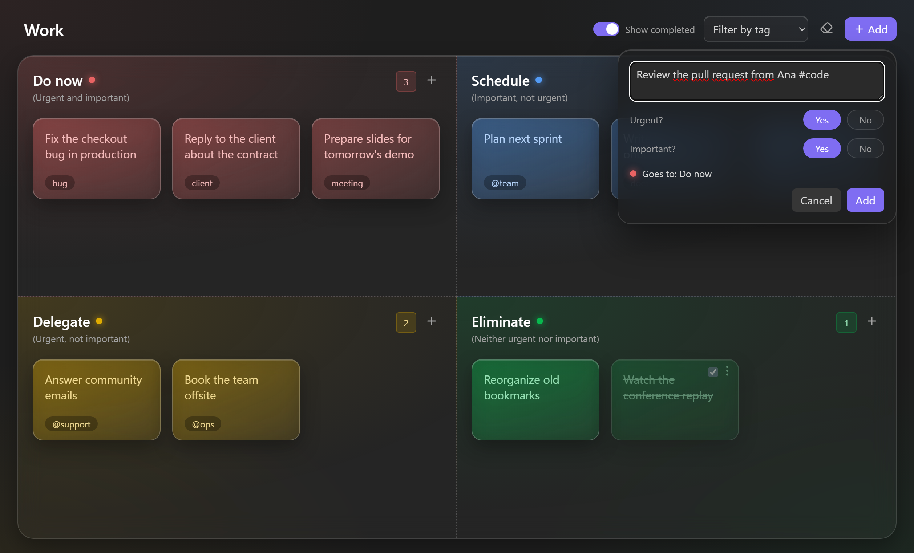
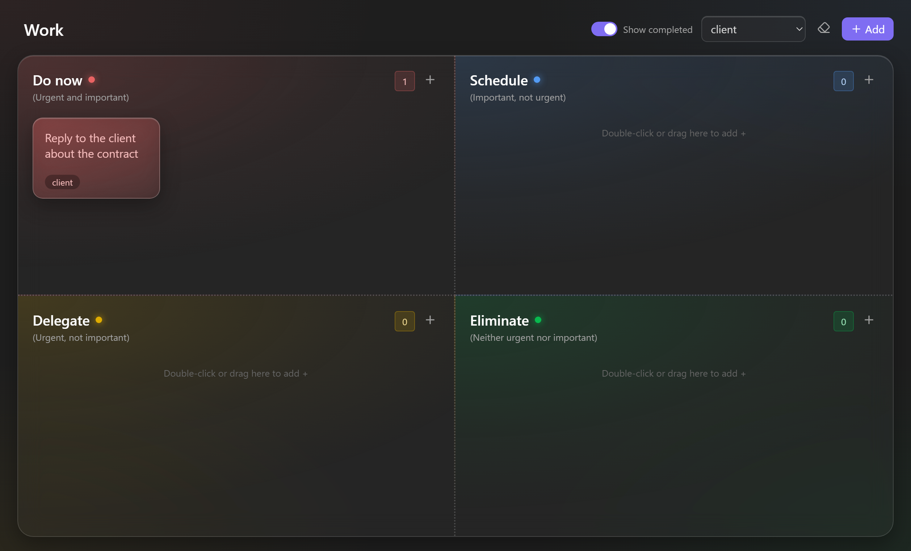
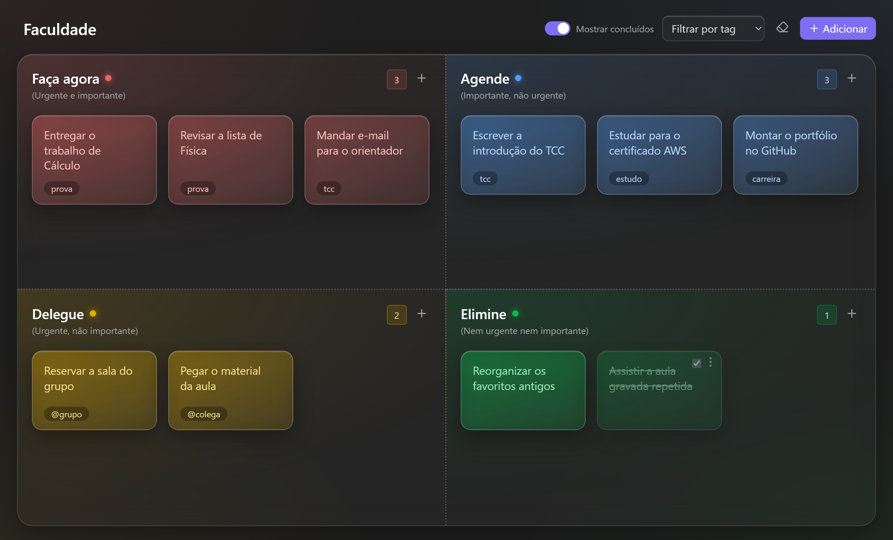

<h1 align="center">Eisenhower Post-its</h1>

<p align="center">
  Turn any note into a glassy Eisenhower matrix and organize your priorities as sticky notes.<br>
  One matrix for work, one for college, one for your side project.
</p>

<p align="center">
  <a href="https://github.com/phzmedeiros/eisenhower-postits/releases/latest"></a>
  <a href="https://github.com/phzmedeiros/eisenhower-postits/releases"></a>
  <a href="LICENSE"></a>
  
</p>

<p align="center">
  <a href="https://www.buymeacoffee.com/phzmedeiros"></a>
</p>

<picture>
  <source media="(prefers-color-scheme: light)" srcset="https://raw.githubusercontent.com/phzmedeiros/eisenhower-postits/main/docs/light-theme.png">
  
</picture>

<details>
  <summary><b>Switch theme</b>: see the matrix in the other theme</summary>
  <br>
  <picture>
    <source media="(prefers-color-scheme: light)" srcset="https://raw.githubusercontent.com/phzmedeiros/eisenhower-postits/main/docs/hero-dark.png">
    
  </picture>
</details>

## Star history

<a href="https://www.star-history.com/?repos=phzmedeiros%2Feisenhower-postits&type=date&logscale&releases&legend=bottom-right">
  <picture>
    <source media="(prefers-color-scheme: dark)" srcset="https://api.star-history.com/chart?repos=phzmedeiros/eisenhower-postits&type=date&theme=dark&logscale&legend=bottom-right">
    <source media="(prefers-color-scheme: light)" srcset="https://api.star-history.com/chart?repos=phzmedeiros/eisenhower-postits&type=date&logscale&legend=bottom-right">
    
  </picture>
</a>

## Why

The Eisenhower matrix splits work by two questions: **is it urgent?** and **is it important?** The answers tell you what to do with each task.

| | Urgent | Not urgent |
| --- | --- | --- |
| **Important** | **Do now** (red) | **Schedule** (blue) |
| **Not important** | **Delegate** (amber) | **Eliminate** (green) |

The colors follow the same logic. Urgency sets the temperature: warm colors for what cannot wait, cool colors for what can. Importance sets the strength. Red, "act now", sits diagonally opposite green, "let it go".

## Features

- **A matrix is a note.** Each matrix is a regular Markdown file in your vault, so it works with search, links, backlinks, sync and version control.
- **Answer two questions, get the right quadrant.** The **Add** button asks *Urgent?* and *Important?* and drops the sticky note in the right place.
- **Drag and drop** between quadrants and to reorder inside a quadrant.
- **Tags as chips.** Write `#client` or `@team` in a sticky note and it becomes a chip. Click a chip, or use **Filter by tag**, to focus on one context.
- **Markdown inside sticky notes**, including `[[internal links]]` and web links.
- **Complete, hide and clear.** Tick a sticky note when it is done, hide completed ones, or clear them in one step.
- **Rename anything in place.** The note name is the matrix title, and you can double-click a quadrant title to rename it.
- **Light and dark themes**, following your Obsidian theme.
- **Mobile friendly.** Every sticky note has a menu to edit, complete, move or delete it, so you do not need drag and drop on a phone.
- **English and Portuguese** interface, following your Obsidian language.

### Add a sticky note by answering two questions



### Filter by tag



## Getting started

1. Install the plugin and enable it in **Settings → Community plugins**.
2. Click the grid icon in the ribbon, run **Create new matrix** from the command palette, or right-click a folder and choose **New Eisenhower matrix**.
3. Give the matrix a title at the top of the board.
4. Click **Add**, type the task, answer *Urgent?* and *Important?*, and press **Enter**.

### Shortcuts

| Where | Action |
| --- | --- |
| Quadrant | **+** or double-click an empty area to add a sticky note there |
| Sticky note | Click to edit. **Enter** saves, **Shift+Enter** adds a new line, **Esc** cancels |
| Sticky note | Right-click or **⋮** to edit, complete, move or delete |
| Quadrant title | Double-click to rename |
| Command palette | **Add sticky note**, **Add sticky note to: Do now** and the other quadrants, **Toggle between matrix and Markdown** |

All commands can be bound to hotkeys in **Settings → Hotkeys**.

## File format

A matrix is plain Markdown with the `eisenhower-plugin` property. Each quadrant is a level 2 heading, in this order: do, schedule, delegate, eliminate. Each sticky note is a task item.

```markdown
---
eisenhower-plugin: board
---

## Do now

- [ ] Fix the checkout bug in production #bug
- [x] Call the bank

## Schedule

- [ ] Study for the AWS exam #study
    Lines indented with four spaces continue the sticky note.

## Delegate

- [ ] Book the team offsite @ops

## Eliminate
```

You can switch to the raw Markdown at any time with the document icon at the top of the matrix. Other properties in the frontmatter are kept. Text outside the task items is not kept when the matrix saves.

## Settings

| Setting | Description |
| --- | --- |
| Folder for new matrices | Where new matrices are created. Leave it empty to use the folder of the active note. |
| Show completed | Keep completed sticky notes visible at the end of each quadrant. |

## Installation

### From Community plugins

Search for **Eisenhower Post-its** in **Settings → Community plugins → Browse**.

### Manually

1. Download `main.js`, `manifest.json` and `styles.css` from the [latest release](https://github.com/phzmedeiros/eisenhower-postits/releases/latest).
2. Copy them to `<vault>/.obsidian/plugins/eisenhower-postits/`.
3. Reload Obsidian and enable **Eisenhower Post-its**.

## Em português

Plugin para o Obsidian que transforma uma nota numa matriz de Eisenhower com post-its de vidro. Crie uma matriz para cada área da sua vida: trabalho, faculdade, empreendimento. O botão **Adicionar** pergunta *Urgente?* e *Importante?* e já coloca o post-it no quadrante certo. A interface fica em português quando o Obsidian está em português.



## Development

```bash
npm install
npm run dev
npm run build
npm run lint
```

`npm run dev` rebuilds `main.js` on every change. Point it at a test vault by cloning the repository into `<vault>/.obsidian/plugins/eisenhower-postits/`.

## Support

Bug reports and ideas are welcome in [Issues](https://github.com/phzmedeiros/eisenhower-postits/issues). If the plugin helps you, a star on the repository helps other people find it, and you can [buy me a coffee](https://www.buymeacoffee.com/phzmedeiros) to keep the project going.

## License

[MIT](LICENSE) © Pedro Henrique Medeiros dos Reis
